# AWS EC2 쇼핑몰 서버 구축 기록

신선식품 쇼핑몰 싱싱마켓(Django + MariaDB + 토스페이먼츠)을 AWS EC2에 직접 배포한 과정을, 처음 하는 사람도 따라 할 수 있게 가이드 형식으로 정리했습니다.
서버 준비는 **휴대폰(AWS 콘솔 모바일 웹·AWS Console 앱)**으로, 코드 배포는 PC(PowerShell)로 진행했고, 막혔던 오류와 해결 과정도 그대로 남겼습니다.

> 🔗 **데모**: http://43.202.26.183
> 실습용 배포입니다. 결제는 **토스페이먼츠 테스트 모드**라 실제로 돈이 빠져나가지 않습니다. 아직 HTTPS가 아니므로 다른 곳에서 쓰는 비밀번호로 가입하지 마세요.

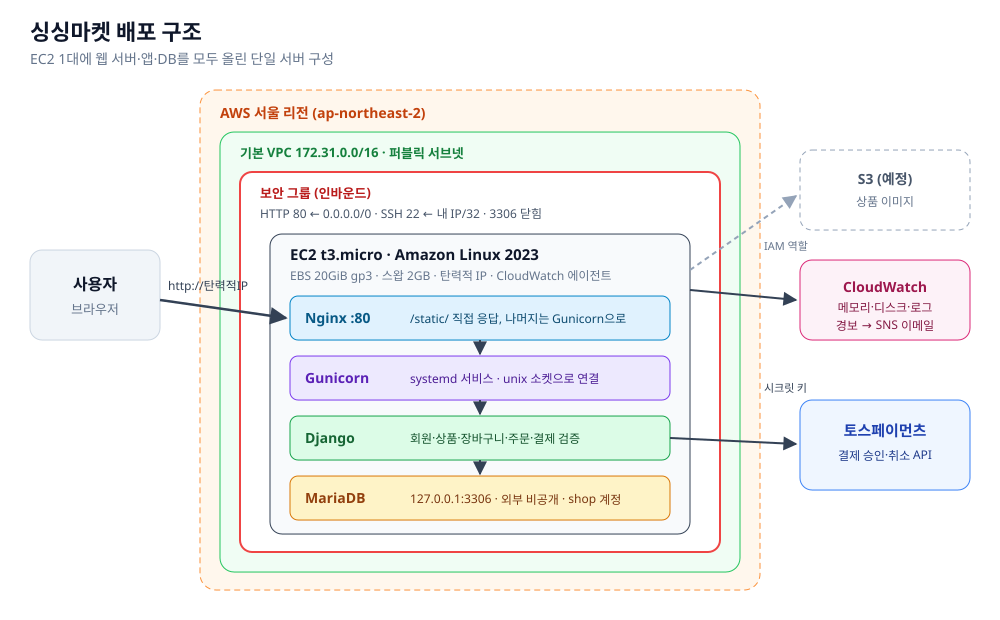

## 목차
1. [진행 현황](#진행-현황)
2. [Part 1. AWS 계정·IAM 준비](#part-1-aws-계정iam-준비)
3. [Part 2. EC2 인스턴스 만들기](#part-2-ec2-인스턴스-만들기)
4. [Part 3. 서버 기본 설정 (휴대폰)](#part-3-서버-기본-설정-휴대폰)
5. [Part 4. 코드 배포 (PC)](#part-4-코드-배포-pc)
6. [Part 5. 동작 확인](#part-5-동작-확인)
7. [Part 6. 모니터링 (CloudWatch)](#part-6-모니터링-cloudwatch)
8. [트러블슈팅](#트러블슈팅)
9. [보안·비용 체크리스트](#보안비용-체크리스트)
10. [회고](#회고)
11. [다음 할 일](#다음-할-일)

## 진행 현황

- [o] IAM 사용자 생성 (그룹으로 권한 관리)
- [o] EC2용 IAM 역할 생성·연결 (CloudWatch 에이전트용)
- [o] EC2 인스턴스 생성 (t3.micro, 20GiB gp3, 서울 리전)
- [o] 보안 그룹 설정 (SSH 22, HTTP 80)
- [o] 탄력적 IP 할당·연결
- [o] EC2 Instance Connect로 접속
- [o] 패키지 설치 (Python 3.11, Nginx, MariaDB, unzip)
- [o] 스왑 2GB 설정
- [o] MariaDB 쇼핑몰 DB·계정 생성
- [o] 코드 업로드 및 배포 (Gunicorn + Nginx)
- [o] CloudWatch 모니터링 (기본 지표, 에이전트로 메모리·디스크·스왑·Nginx 로그, 경보)
- [ ] S3로 상품 이미지 분리
- [ ] SSH 접근 범위 축소, HTTPS 적용

## 사용 기술

| 구분 | 사용 |
|---|---|
| 클라우드 | AWS EC2(t3.micro), EBS(gp3 20GiB), 탄력적 IP, 보안 그룹, IAM |
| OS | Amazon Linux 2023 |
| 웹 서버 / 앱 서버 | Nginx, Gunicorn(systemd) |
| 백엔드 | Python 3.11, Django 5.2 |
| DB | MariaDB 10.5 (EC2 내부, 외부 비공개) |
| 결제 | 토스페이먼츠 결제위젯 v2 (테스트 모드) |
| 모니터링 | CloudWatch(지표·Logs·경보), CloudWatch 에이전트, SNS 이메일 알림 |

쇼핑몰 코드는 [`ssingssing/`](ssingssing) 폴더에 있습니다. (`.env`·DB 파일은 제외)

---

## Part 1. AWS 계정·IAM 준비

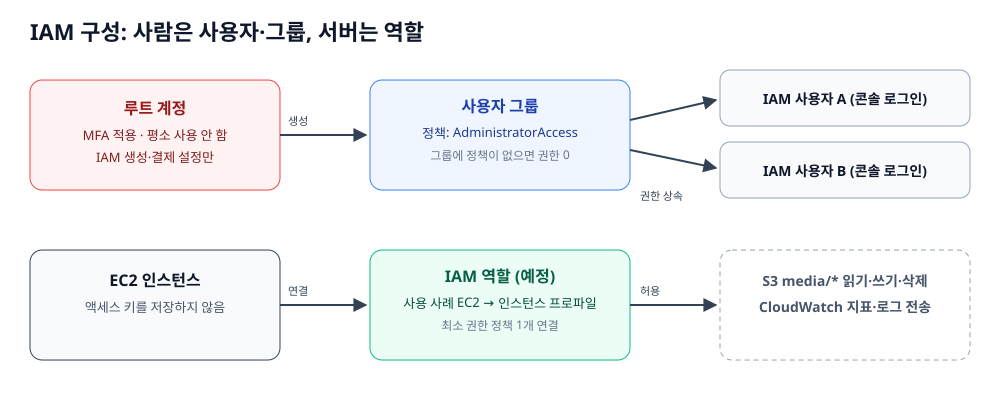

**원칙**: 루트 계정(가입한 이메일)은 결제 정보까지 모든 권한을 가진 마스터 키라서 **IAM 사용자 생성까지만** 쓰고, 이후 작업은 IAM 사용자로 합니다. 서버(EC2)에는 액세스 키 대신 **IAM 역할**로 권한을 줍니다.

### 1-1. IAM 사용자 만들기
IAM → IAM 사용자 → **사용자 생성**

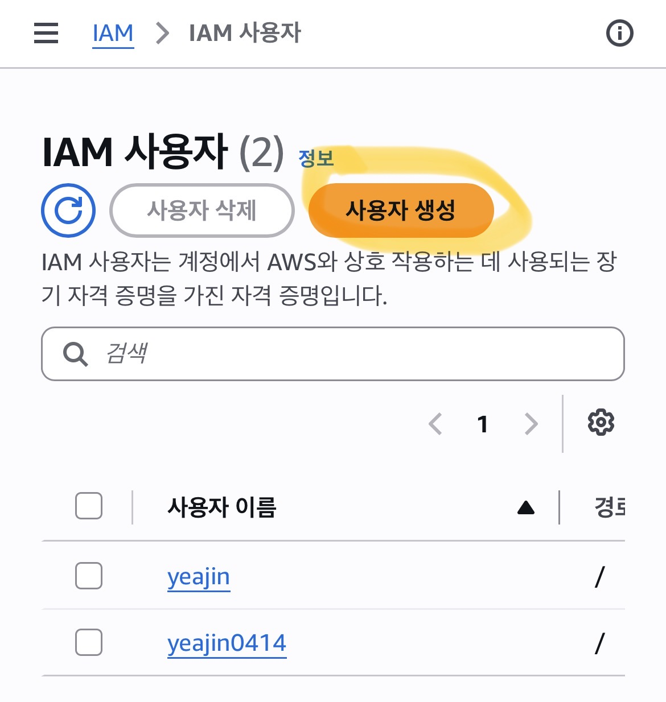

- **AWS Management Console에 대한 사용자 액세스 권한 제공**에 체크해야 콘솔 암호 항목이 나타납니다.
- 콘솔 암호: 사용자 지정 암호 (8자 이상, 대문자·소문자·숫자·기호 중 3가지 이상)
- **다음 로그인 시 새 암호 생성** 체크 → 첫 로그인 때 비밀번호를 다시 정하게 함

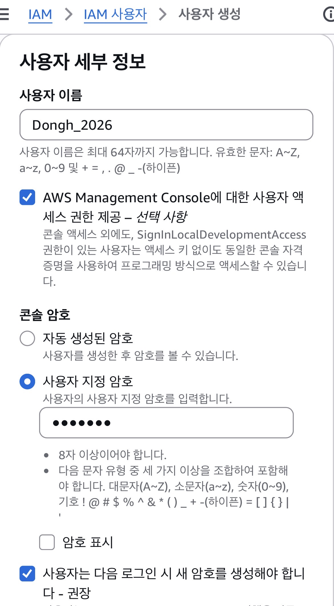

### 1-2. 권한: 그룹에 사용자 추가

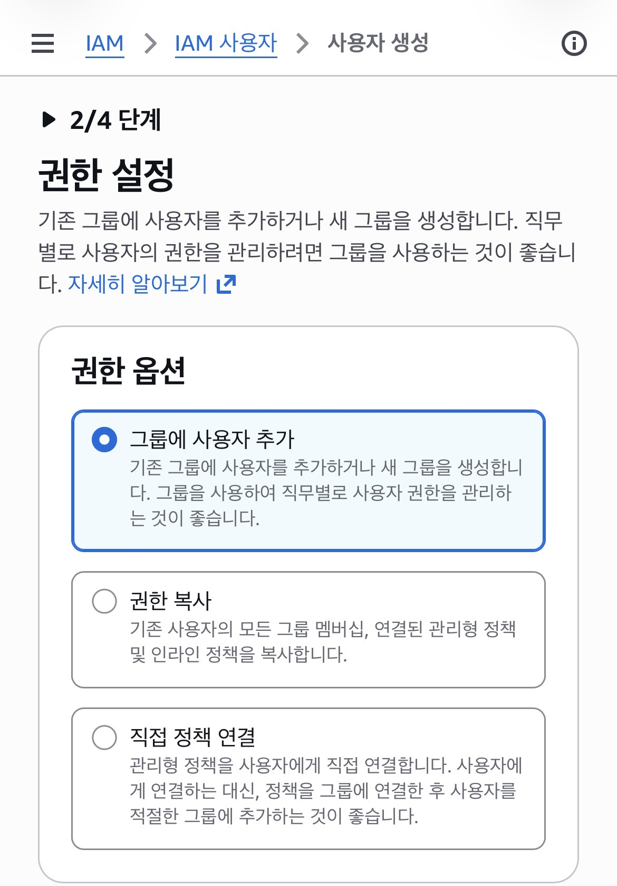

| 옵션 | 방식 |
|---|---|
| **그룹에 사용자 추가**  | 권한을 그룹에 주고 사용자를 그룹에 넣음. 사용자가 늘어도 그룹만 관리하면 됨 (AWS 권장) |
| 권한 복사 | 기존 사용자의 권한을 그대로 복사 |
| 직접 정책 연결 | 사용자 한 명에게 정책을 바로 붙임 |

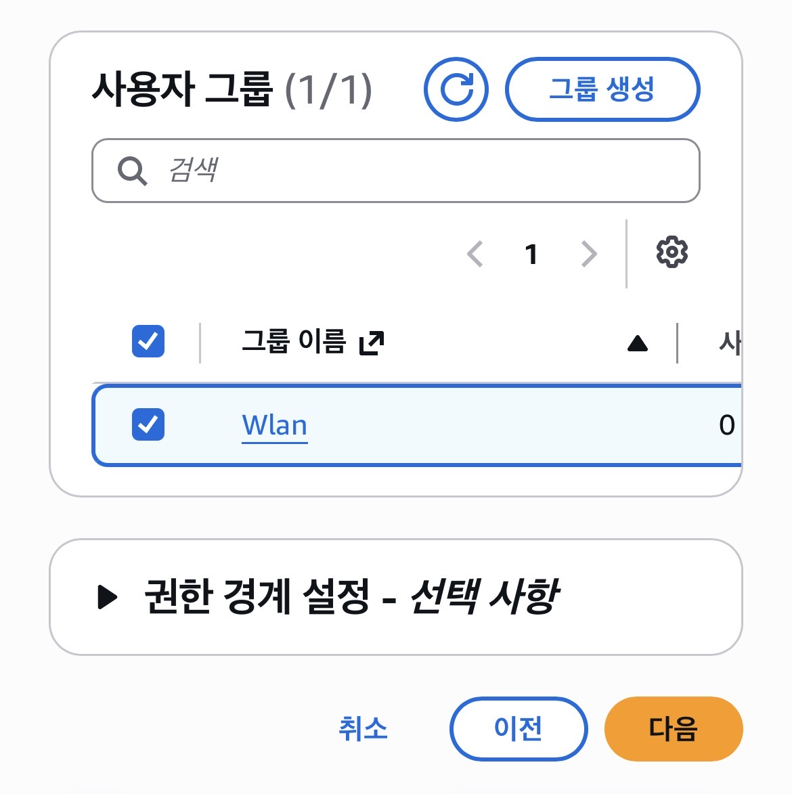

>  **그룹에 넣는 것만으로는 권한이 생기지 않습니다.** 그룹의 **권한** 탭에 정책(예: `AdministratorAccess`)이 붙어 있어야 합니다. → [트러블슈팅 ④](#-iam-사용자로-로그인하니-ec2가-안-보임)

### 1-3. 검토 및 생성
- `IAMUserChangePassword`(AWS 관리형)가 자동으로 붙음 → '다음 로그인 시 새 암호 생성'을 체크했기 때문에 사용자가 자기 비밀번호를 바꿀 수 있도록 추가됨
- 완료 화면의 **콘솔 로그인 URL**(`https://<계정ID>.signin.aws.amazon.com/console`)은 IAM 사용자 전용 주소라 따로 저장. 암호는 이 화면에서만 확인 가능

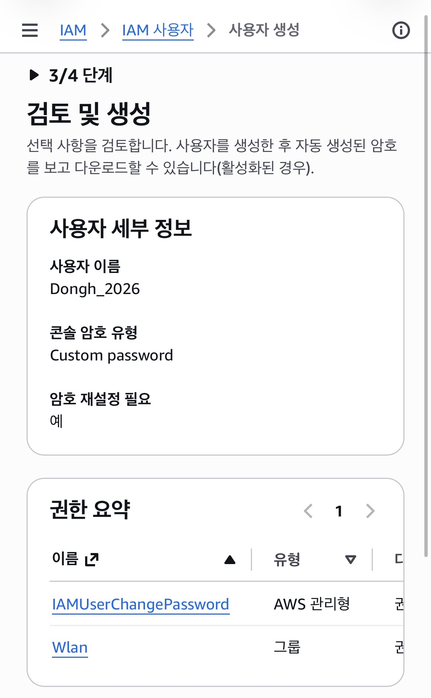 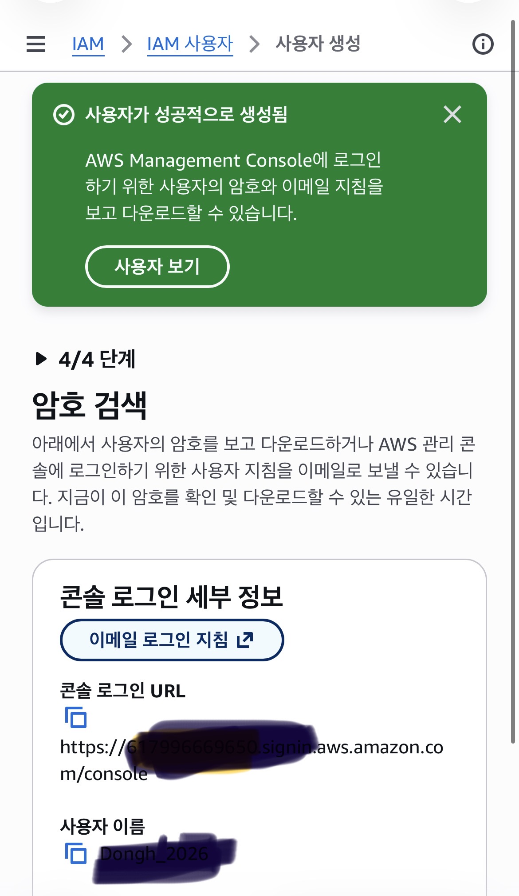

### 1-4. EC2용 IAM 역할
서버(EC2) 안의 프로그램이 AWS를 쓰려면 **사용자가 아니라 역할**이 필요합니다.

| 항목 | 설정 |
|---|---|
| 역할 이름 | `ssingssing-ec2-role` |
| 신뢰할 수 있는 엔터티 | AWS 서비스 → **EC2** (`ec2.amazonaws.com`) |
| 권한 정책 | `CloudWatchAgentServerPolicy` (AWS 관리형) |
| 연결 | EC2 → 인스턴스 → 작업 → 보안 → **IAM 역할 수정** |

> 사용 사례를 EC2로 골라야 '인스턴스 프로파일'이 함께 만들어져서 EC2 화면 목록에 나타납니다.

S3 연동 단계에서 같은 역할에 추가할 최소 권한 정책(예정)은 아래와 같습니다.

<details>
<summary>S3·CloudWatch 최소 권한 정책 JSON 보기</summary>

```json
{
  "Version": "2012-10-17",
  "Statement": [
    {
      "Sid": "ShopImagesS3",
      "Effect": "Allow",
      "Action": ["s3:PutObject", "s3:GetObject", "s3:DeleteObject"],
      "Resource": "arn:aws:s3:::<버킷이름>/media/*"
    },
    {
      "Sid": "CloudWatchMetrics",
      "Effect": "Allow",
      "Action": ["cloudwatch:PutMetricData", "ec2:DescribeVolumes", "ec2:DescribeTags"],
      "Resource": "*"
    },
    {
      "Sid": "CloudWatchLogs",
      "Effect": "Allow",
      "Action": [
        "logs:CreateLogGroup", "logs:CreateLogStream", "logs:PutLogEvents",
        "logs:DescribeLogGroups", "logs:DescribeLogStreams", "logs:PutRetentionPolicy"
      ],
      "Resource": "*"
    },
    {
      "Sid": "CloudWatchAgentConfig",
      "Effect": "Allow",
      "Action": "ssm:GetParameter",
      "Resource": "arn:aws:ssm:*:*:parameter/AmazonCloudWatch-*"
    }
  ]
}
```
</details>

| 묶음 | 하는 일 |
|---|---|
| ShopImagesS3 | 상품 이미지 올리기·읽기·지우기 (버킷의 `media/` 폴더로 범위 제한) |
| CloudWatchMetrics | 메모리·디스크 지표 전송 (CPU 외 지표는 에이전트 필요) |
| CloudWatchLogs | Nginx·Django 로그 전송 |
| CloudWatchAgentConfig | CloudWatch 에이전트 설정 불러오기 |

DB는 서버 안에서 비밀번호로, 결제는 토스 키로 동작해서 AWS 권한이 필요 없습니다.

---

## Part 2. EC2 인스턴스 만들기

### 2-1. 이름·AMI·유형
EC2 → **인스턴스 시작** → 단계별 학습 없이 실행

 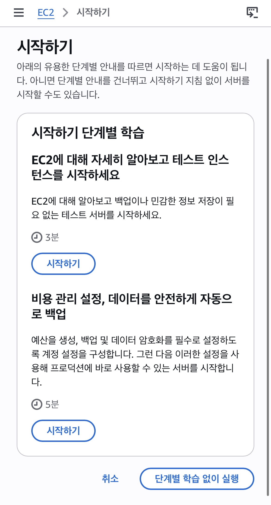

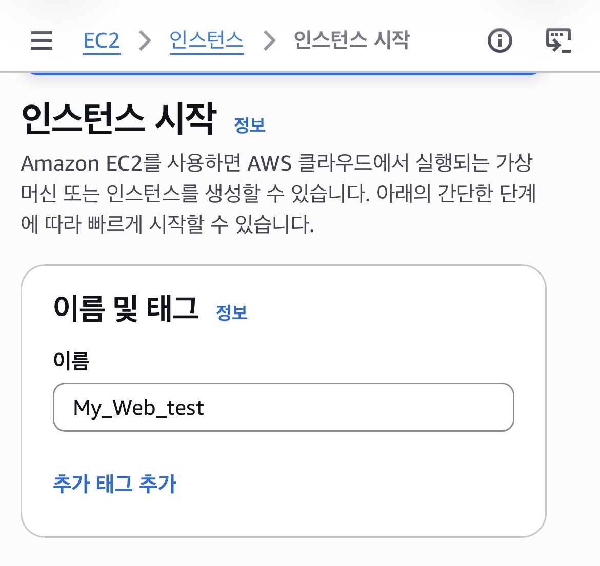 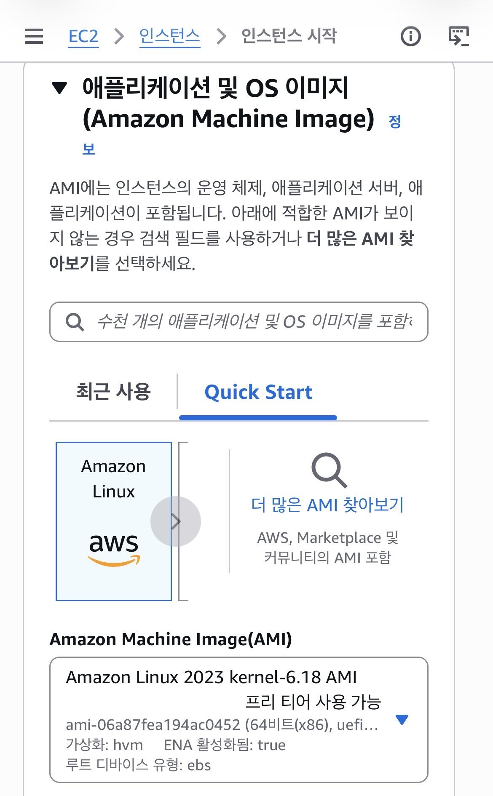 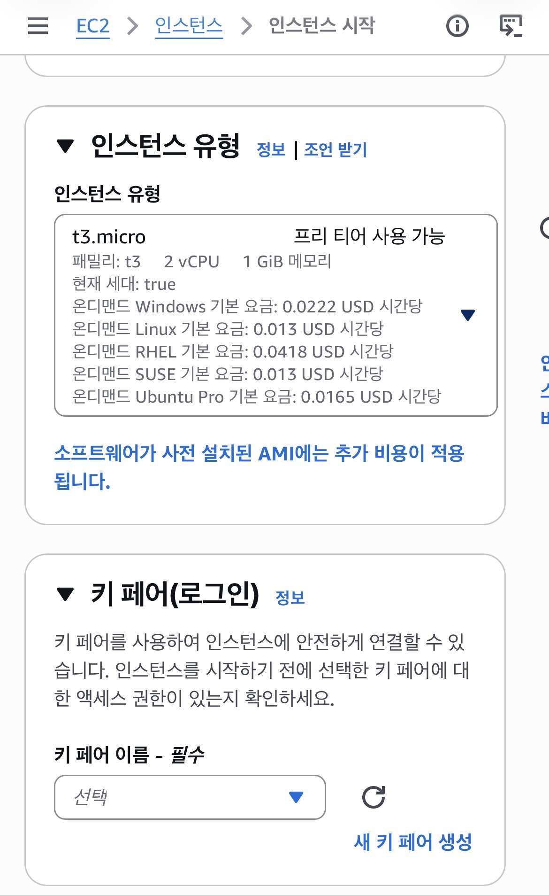

| 항목 | 설정 | 이유 |
|---|---|---|
| 리전 | 서울 (ap-northeast-2) | 한국 사용자 대상. 리소스는 리전별로 따로 보이므로 항상 리전부터 확인 |
| AMI | Amazon Linux 2023 (프리 티어) | AWS가 관리, 가볍고 Nginx·Gunicorn이 리눅스 기준. Gunicorn은 Windows에서 동작하지 않음 |
| 유형 | t3.micro (2 vCPU, 1GiB) | 프리 티어. Linux 요금이 Windows보다 저렴 |
| 개수 | 1 | 1대에 웹·앱·DB를 모두 올리는 구조 |

### 2-2. 키 페어
서버 접속용 열쇠. 서버에는 공개 키가 들어가고, 내려받은 `.pem`(개인 키)으로 로그인합니다. **다시 다운로드할 수 없음.**
- 유형 **RSA** / 형식 **.pem** (OpenSSH용, Windows 10 이상·Mac 공용. `.ppk`는 PuTTY용)

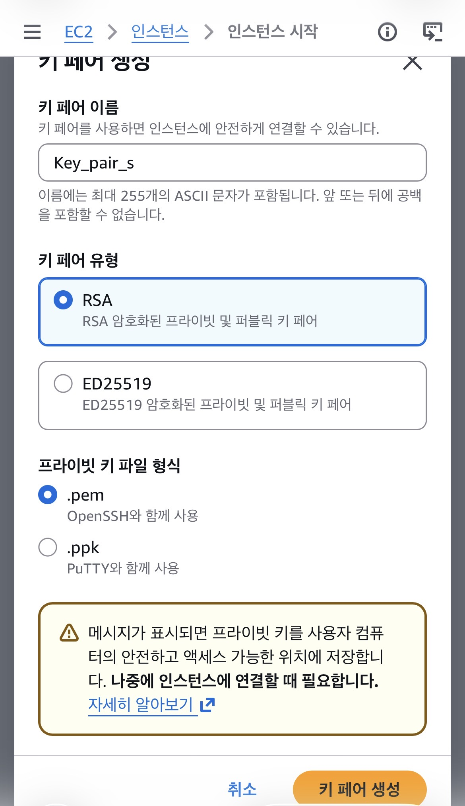 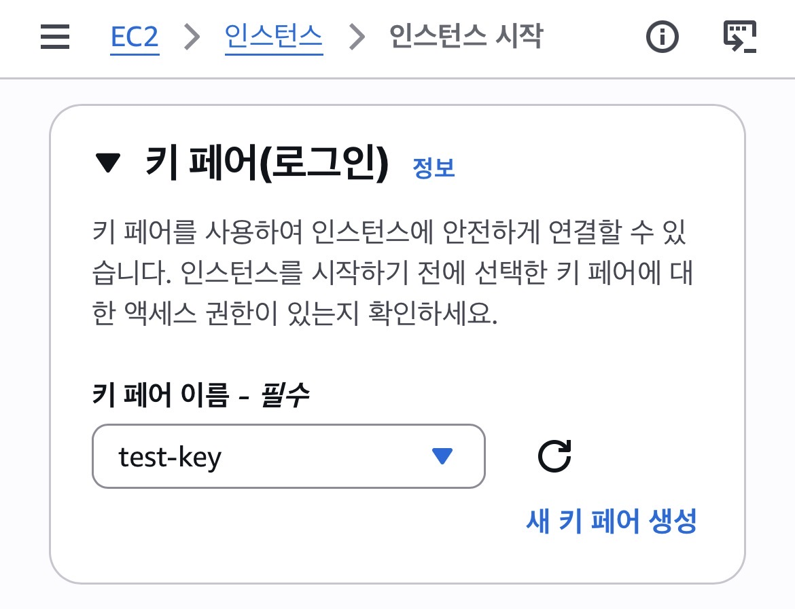

### 2-3. 네트워크
- VPC: **기본 VPC** (`172.31.0.0/16`), 서브넷·가용 영역: 기본 설정 없음
- 퍼블릭 IP 자동 할당: **활성화**

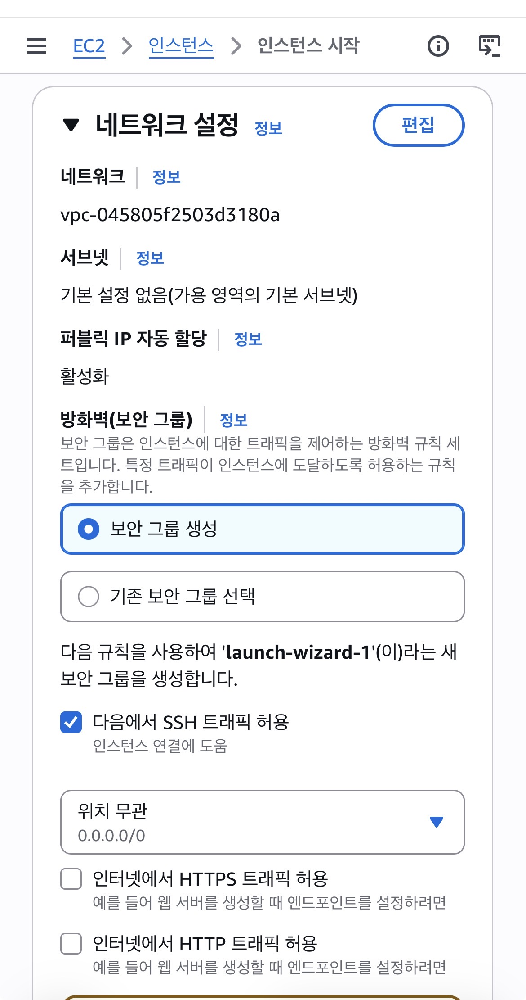 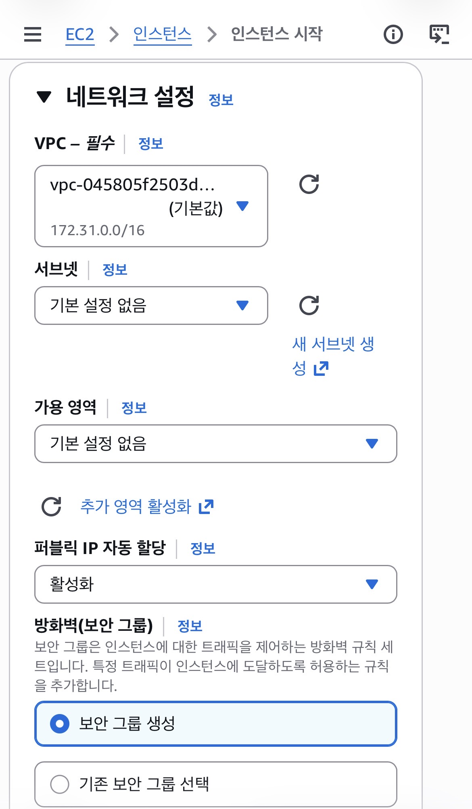

### 2-4. 보안 그룹 (방화벽)

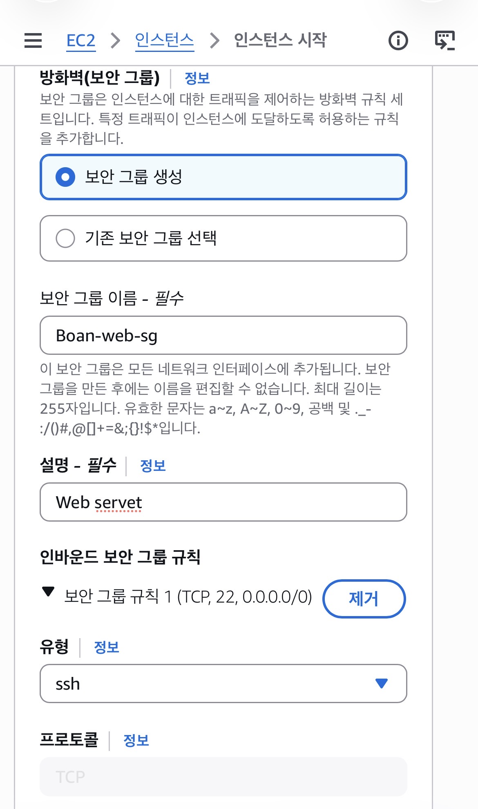 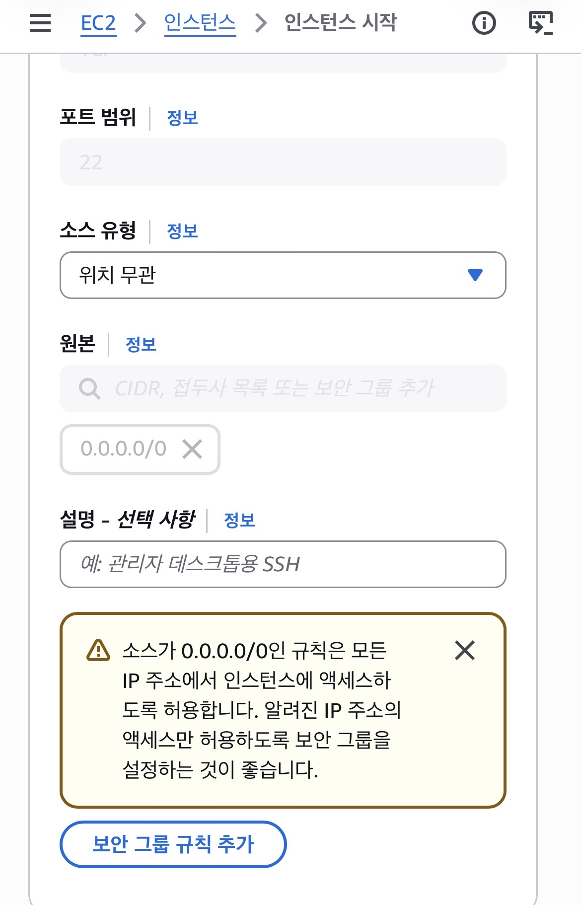 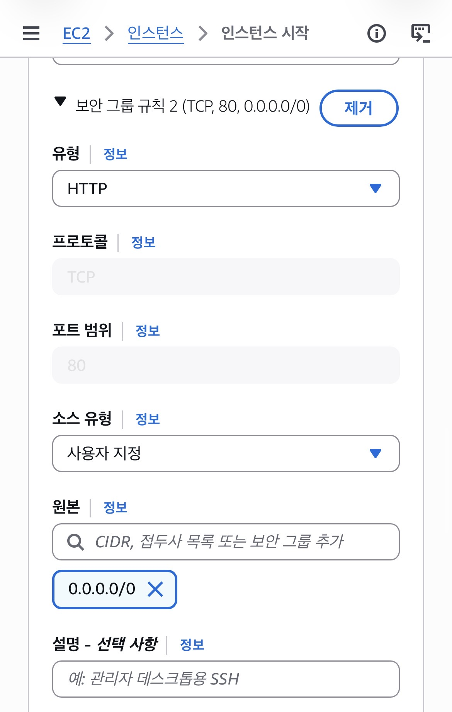

| 규칙 | 유형 | 포트 | 소스 | 이유 |
|---|---|---|---|---|
| 1 | SSH | 22 | 0.0.0.0/0 → 배포 후 `내IP/32` | 휴대폰·PC IP가 달라 설정 기간에만 임시 개방 |
| 2 | HTTP | 80 | 0.0.0.0/0 | 손님 IP를 알 수 없으므로 전체 허용 |
| - | MySQL | 3306 | **열지 않음** | DB는 서버 내부에서만 사용 |

> CIDR 정리: `/32` = 주소 1개, `/24` = 256개, `/0` = 모든 주소

### 2-5. 스토리지
- 루트 볼륨 **20GiB gp3** (프리 티어 30GB 이내, 기본 3000 IOPS)
- 파일 시스템(S3 Files·EFS·FSx): **없음** — 서버 1대라 공유 파일 시스템 불필요

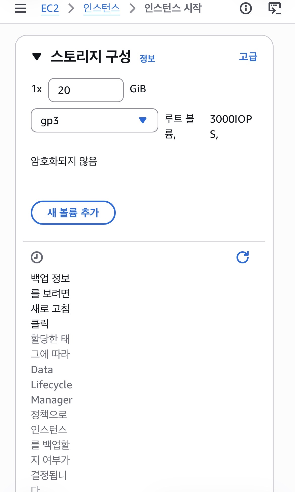 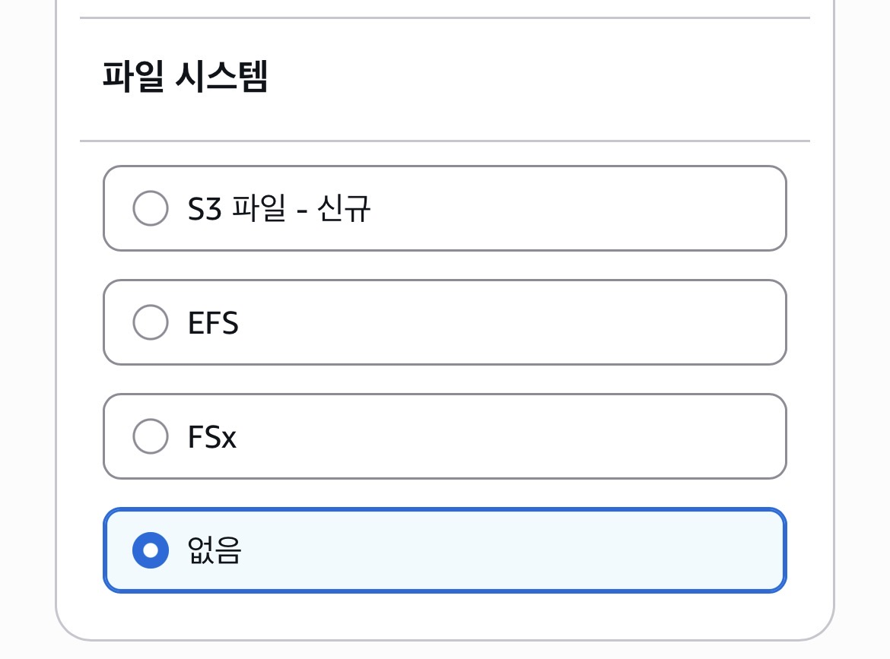

시작 후 추천 카드의 **RDS 연결은 건너뜀** (DB를 EC2 안에 직접 설치).

### 2-6. 탄력적 IP
자동 할당 퍼블릭 IP는 인스턴스를 중지했다 켜면 바뀌므로 고정 주소를 붙입니다.
1. EC2 → 네트워크 및 보안 → 탄력적 IP → **할당**
2. 작업 → **탄력적 IP 주소 연결** → 리소스 유형: 인스턴스, 프라이빗 IP: `172.31.x.x`
3. 인스턴스 상세에서 퍼블릭 IP가 탄력적 IP로 바뀐 것 확인

> 할당만 하고 연결하지 않으면 과금. 삭제 시 연결 해제 후 **릴리스**까지 해야 합니다.

---

## Part 3. 서버 기본 설정 (휴대폰)

인스턴스 → **연결** → EC2 Instance Connect → **퍼블릭 IPv4 주소로 연결**, 사용자 `ec2-user`
브라우저 터미널이라 `.pem` 없이 휴대폰에서도 접속할 수 있습니다.

```
   ,     #_
   ~\_  ####_        Amazon Linux 2023
  ~~  \_#####\
  ~~     \###|
  ~~       \#/ ___   https://aws.amazon.com/linux/amazon-linux-2023
   ~~       V~' '->
    ~~~         /
      ~~._.   _/
         _/ _/
       _/m/'
[ec2-user@ip-172-31-x-x ~]$
```

> 프롬프트로 위치 구분하기: `[ec2-user@... ~]$` = 리눅스 셸, `MariaDB [(none)]>` = DB 안

### 3-1. 패키지 설치 + 스왑
```bash
sudo dnf update -y && sudo dnf install -y python3.11 python3.11-pip nginx mariadb105-server unzip

# t3.micro는 메모리 1GB → 스왑 2GB 추가
sudo dd if=/dev/zero of=/swapfile bs=1M count=2048 && sudo chmod 600 /swapfile \
  && sudo mkswap /swapfile && sudo swapon /swapfile \
  && echo '/swapfile swap swap defaults 0 0' | sudo tee -a /etc/fstab
free -h   # Swap: 2.0Gi
```

### 3-2. MariaDB
```bash
sudo systemctl enable --now mariadb
sudo mysql            # root는 unix_socket → sudo로 비밀번호 없이 접속
```
```sql
CREATE DATABASE ssingssing CHARACTER SET utf8mb4 COLLATE utf8mb4_unicode_ci;
CREATE USER 'shop'@'localhost' IDENTIFIED BY '<shop_비밀번호>';
GRANT ALL PRIVILEGES ON ssingssing.* TO 'shop'@'localhost';
GRANT ALL PRIVILEGES ON test_ssingssing.* TO 'shop'@'localhost';   -- manage.py test용 임시 DB
FLUSH PRIVILEGES;
EXIT;
```

| 계정 | 사용 주체 | 접속 방법 |
|---|---|---|
| root | 관리자 | `sudo mysql` (unix_socket) |
| shop | 쇼핑몰 프로그램 | `.env`의 `DB_PASSWORD`, `ssingssing` DB에만 권한 |

---

## Part 4. 코드 배포 (PC)

### 4-0. 준비
- `C:\aws` 폴더에 `ssingssing.zip`과 인스턴스의 키 페어 `.pem`을 둠 (인스턴스 세부 정보의 **키 페어 이름**과 같은 파일이어야 함)
- 토스페이먼츠 [개발자센터](https://developers.tosspayments.com) → API 키 → **결제위젯 연동 키**(`test_gck_`, `test_gsk_`). 테스트 키는 사업자 없이 사용 가능

### 4-1. 키 권한 정리 + 접속 (PowerShell)
```powershell
cd C:\aws
icacls .\<키>.pem /inheritance:r
icacls .\<키>.pem /grant:r "$($env:USERNAME):(R)"   # $env:USERNAME은 그대로 입력
ssh -i .\<키>.pem ec2-user@<탄력적IP>              # 첫 접속 시 yes
```
> Mac: `chmod 400 <키>.pem`

### 4-2. 업로드 → 설치
```powershell
scp -i .\<키>.pem .\ssingssing.zip ec2-user@<탄력적IP>:~
```
```bash
# 서버에서
cd ~ && unzip -q ssingssing.zip -d ssingssing && cd ssingssing
python3.11 -m venv venv && source venv/bin/activate
pip install -r requirements.txt
```

### 4-3. `.env` (비밀값)
비밀번호·키를 코드에 쓰지 않고 서버에만 둡니다. `< >`는 값을 넣을 자리 표시라 **꺾쇠까지 지우고** 값만 넣습니다.
```bash
cat > .env << EOF
DJANGO_SECRET_KEY=$(python -c "import secrets; print(secrets.token_urlsafe(50))")
DEBUG=false
ALLOWED_HOSTS=<탄력적IP>
CSRF_TRUSTED_ORIGINS=http://<탄력적IP>
DB_ENGINE=mysql
DB_NAME=ssingssing
DB_USER=shop
DB_PASSWORD=<shop_비밀번호>
DB_HOST=127.0.0.1
DB_PORT=3306
TOSS_CLIENT_KEY=<test_gck_...>
TOSS_SECRET_KEY=<test_gsk_...>
USE_S3=false
USE_HTTPS=false
EOF
chmod 600 .env      # -rw------- : 나만 읽기·쓰기
```

### 4-4. DB 테이블·관리자·테스트
```bash
mysql -u shop -p<shop_비밀번호> -e "SHOW DATABASES;"   # ssingssing 보이면 연결 OK
python manage.py migrate
python manage.py collectstatic --noinput
python manage.py seed_products        # 샘플 상품 8개
python manage.py createsuperuser      # 쇼핑몰 관리자 (AWS IAM과 별개)
python manage.py test orders          # 5개 테스트 OK
```

### 4-5. Gunicorn (systemd)
```bash
sudo cp deploy/gunicorn.service /etc/systemd/system/ssingssing.service
sudo systemctl daemon-reload
sudo systemctl enable --now ssingssing
sudo systemctl status ssingssing --no-pager   # active (running)
```
systemd에 등록해서 서버가 재부팅되거나 프로세스가 죽어도 자동으로 다시 켜집니다.

### 4-6. Nginx
```bash
sed -i 's/server_name _;/server_name <탄력적IP>;/' deploy/nginx.conf   # 기본 환영 페이지 대신 쇼핑몰로
sudo cp deploy/nginx.conf /etc/nginx/conf.d/ssingssing.conf
chmod 711 /home/ec2-user        # Nginx가 static 폴더를 읽을 수 있게
sudo nginx -t                   # syntax is ok / test is successful
sudo systemctl enable --now nginx && sudo systemctl restart nginx
```

---

## Part 5. 동작 확인

- `http://<탄력적IP>` → 쇼핑몰 메인
- `http://<탄력적IP>/manage/` → 관리자 (상품·가격·재고, 주문 상태·환불, 회원 정지)
- 회원가입 → 장바구니 → 주문서 → 결제위젯 → 테스트 카드로 결제 → 관리자에서 `결제완료`·재고 감소 확인 → 주문 취소 시 환불·재고 복구 확인

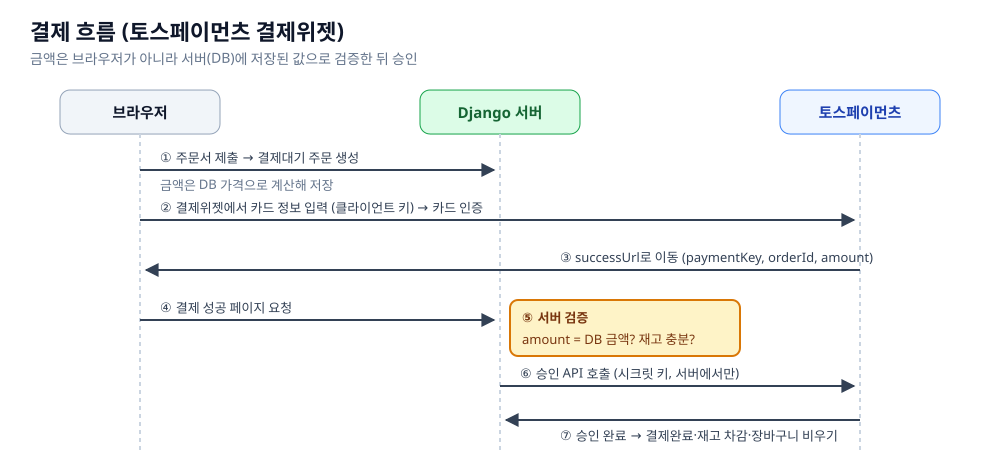

결제 금액은 브라우저가 보낸 값이 아니라 **서버 DB에 저장된 주문 금액**과 비교한 뒤 승인 API를 호출합니다. 금액을 조작하면 승인하지 않고 실패 처리합니다. 시크릿 키는 서버 `.env`에만 있습니다.

### 운영 명령어
```bash
sudo journalctl -u ssingssing -f                           # Django 로그 (결제 승인·취소 기록)
sudo tail -f /var/log/nginx/error.log                      # Nginx 에러
sudo systemctl restart ssingssing                          # 코드·.env 수정 후 반영
mysqldump -u shop -p ssingssing > backup_$(date +%F).sql   # DB 백업
```

---

## Part 6. 모니터링 (CloudWatch)

| 단계 | 볼 수 있는 것 | 필요한 것 |
|---|---|---|
| 기본 지표 | CPU, 네트워크, 디스크 읽기·쓰기, 상태 검사 (5분 간격) | 없음. EC2가 자동 전송 |
| **에이전트** | **메모리·디스크 사용률, 스왑**, Nginx 로그 | IAM 역할 + 서버에 에이전트 설치 |

메모리·디스크 '사용률'은 서버 안에서만 알 수 있어서 AWS 바깥에서는 보이지 않습니다. 메모리 1GB 서버라 메모리 지표가 특히 중요해서 에이전트를 설치했습니다.

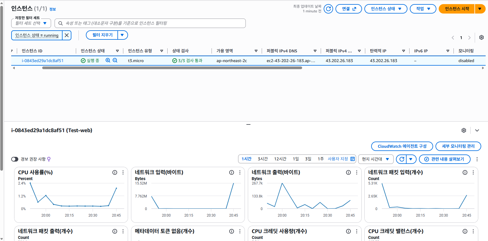

*EC2 모니터링 탭의 기본 지표. 메모리 항목이 없음*

### 6-1. 에이전트 설치·설정
[1-4](#1-4-ec2용-iam-역할)의 IAM 역할을 EC2에 연결한 뒤 서버에서:
```bash
sudo dnf install -y amazon-cloudwatch-agent

sudo tee /opt/aws/amazon-cloudwatch-agent/etc/config.json > /dev/null << 'EOF'
{
  "agent": { "metrics_collection_interval": 60, "run_as_user": "root" },
  "metrics": {
    "namespace": "CWAgent",
    "append_dimensions": { "InstanceId": "${aws:InstanceId}" },
    "metrics_collected": {
      "mem":  { "measurement": ["mem_used_percent"] },
      "swap": { "measurement": ["swap_used_percent"] },
      "disk": { "measurement": ["used_percent"], "resources": ["/"], "drop_device": true }
    }
  },
  "logs": {
    "logs_collected": {
      "files": {
        "collect_list": [
          { "file_path": "/var/log/nginx/access.log", "log_group_name": "/ssingssing/nginx/access", "log_stream_name": "{instance_id}", "retention_in_days": 7 },
          { "file_path": "/var/log/nginx/error.log",  "log_group_name": "/ssingssing/nginx/error",  "log_stream_name": "{instance_id}", "retention_in_days": 7 }
        ]
      }
    }
  }
}
EOF

sudo /opt/aws/amazon-cloudwatch-agent/bin/amazon-cloudwatch-agent-ctl \
  -a fetch-config -m ec2 -s -c file:/opt/aws/amazon-cloudwatch-agent/etc/config.json
sudo systemctl status amazon-cloudwatch-agent --no-pager     # active (running)
```
- 1분마다 메모리·스왑·루트 디스크(`/`) 사용률 전송
- Nginx 접속·에러 로그를 CloudWatch Logs로 전송, **7일만 보관**(요금 관리)

### 6-2. 확인
CloudWatch → 지표 → 모든 지표 → 찾아보기 → **사용자 지정 네임스페이스 `CWAgent`**

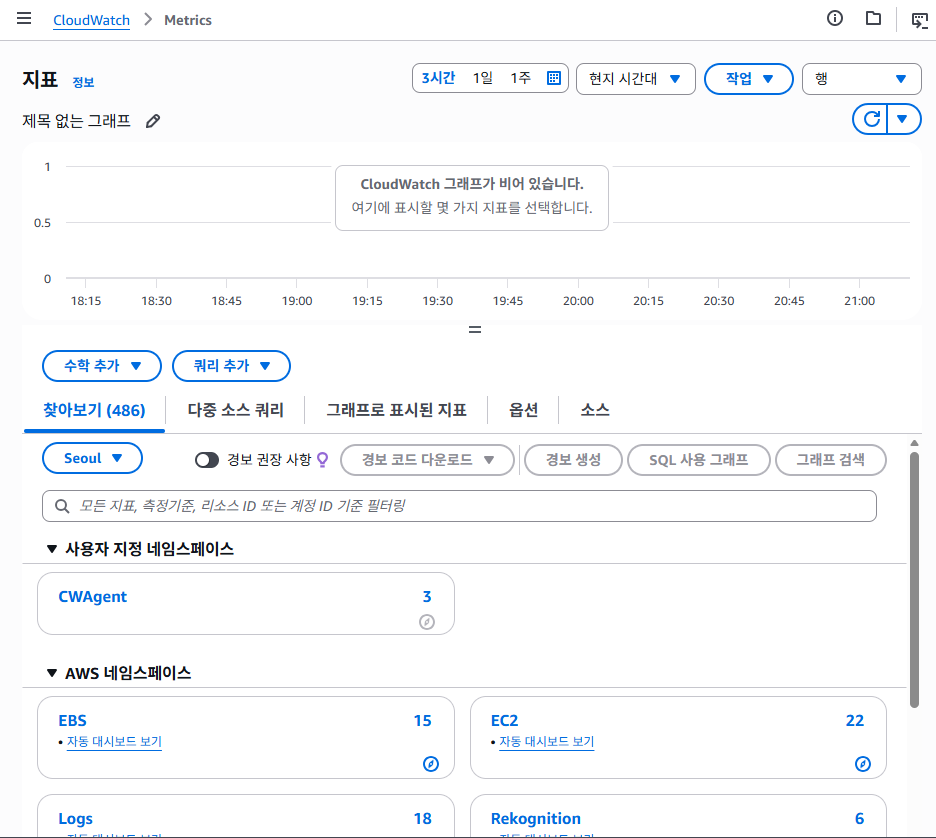 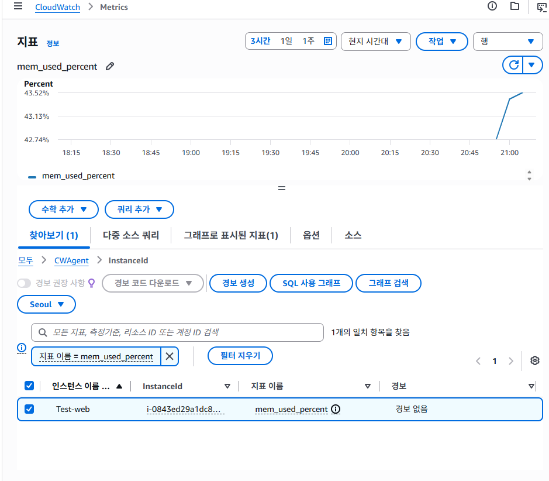

- 메모리 사용률 약 **43%** (Nginx·Gunicorn·Django·MariaDB 동시 구동, 스왑 2GB 별도)
- 지표는 IAM 역할을 연결하고 에이전트를 재시작한 시점부터 들어오기 시작
- 디스크 지표는 `path`·`fstype` 정보가 붙어 **`InstanceId, fstype, path`** 묶음에 따로 있음 → [트러블슈팅 ⑩](#트러블슈팅)

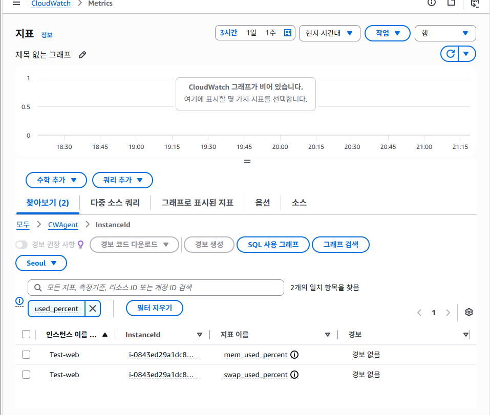

*`InstanceId` 묶음에서 `used_percent`로 검색하면 메모리·스왑만 나오고 디스크는 나오지 않음*

### 6-3. 경보 + 이메일 알림
1. **SNS** → 주제 생성(표준) `ssingssing-alarm` → 구독: 이메일 → 메일의 **Confirm subscription** 클릭
2. **CloudWatch → 경보 → 경보 생성**: 지표 1개만 선택 → 통계 평균, 기간 5분, 정적 임계값 → 알림 대상 `ssingssing-alarm`

| 경보 | 지표 | 조건 |
|---|---|---|
| `ssingssing-cpu-high` | EC2 `CPUUtilization` | > 70% |
| `ssingssing-status-check` | EC2 `StatusCheckFailed` | ≥ 1 |
| `ssingssing-mem-high` | CWAgent `mem_used_percent` | > 80% |
| `ssingssing-disk-high` | CWAgent `used_percent` (path `/`) | > 80% |

> 만든 직후 상태는 **데이터 부족**이 정상입니다. 기간(5분)만큼 데이터가 쌓이면 **정상(OK)**으로 바뀌고, 임계값을 넘으면 **경보** 상태가 되며 이메일이 옵니다.

**요금**: 무료 범위(사용자 지정 지표 10개, 경보 10개, 로그 수집 5GB) 안에서 구성 — 지표 3개, 경보 4개, 로그 7일 보관.

**문제 확인**: `sudo tail -n 30 /opt/aws/amazon-cloudwatch-agent/logs/amazon-cloudwatch-agent.log`

---

## 트러블슈팅

| # | 증상 | 원인 | 해결 |
|---|---|---|---|
| ① | IAM 사용자 생성 화면에 비밀번호 칸이 없음 | 콘솔 액세스 체크박스(선택 사항) 미체크 | 체크하면 콘솔 암호 항목이 나타남 |
| ② | EC2 생성 시 IAM 인스턴스 프로파일 목록이 비어 있음 | EC2용 역할을 아직 안 만듦 | 역할 없이 생성 후 나중에 `IAM 역할 수정`으로 연결 |
| ③ | MariaDB root 접속 불가 | DB 명령을 셸에 입력 + unix_socket을 꺼 버림 | 빈 DB라 데이터 폴더 초기화 |
| ④ | IAM 사용자로 로그인하니 EC2가 안 보임 | 그룹에 권한 정책이 없음 | 그룹 권한 탭에 `AdministratorAccess` 연결 |
| ⑤ | ssh `Identity file not accessible` | 키 파일이 없는 폴더에서 실행 | `cd C:\aws` 후 다시 |
| ⑥ | `.env` 값이 이상함 | `< >` 꺾쇠까지 입력 | `cat > .env`로 덮어써서 다시 작성 |
| ⑦ | `ERROR 2002 ... mysql.sock (13)` | 초기화한 데이터 폴더 권한 700 | 소유자·권한 수정 |
| ⑧ | 테스트 DB 생성 실패 (1044) | shop 계정에 `test_ssingssing` 권한 없음 | 테스트 DB 권한 추가 |
| ⑨ | 에이전트를 켰는데 `CWAgent` 지표가 안 생김 | 정책을 **IAM 사용자(그룹)**에 붙임. 서버는 사람 권한을 못 씀 | EC2용 **IAM 역할** 생성·연결 후 에이전트 재시작 |
| ⑩ | 디스크 지표를 못 찾음 | 디스크 지표는 다른 차원 묶음(`InstanceId, fstype, path`)에 있음 | `CWAgent` → 해당 묶음에서 `path = /` 선택 |

### ③ MariaDB root 접속 불가
```console
[ec2-user@ip-172-31-x-x ~]$ ALTER USER 'root'@'localhost' IDENTIFIED BY '********';
-bash: ALTER: command not found
[ec2-user@ip-172-31-x-x ~]$ sudo mysql
ERROR 1045 (28000): Access denied for user 'root'@'localhost' (using password: NO)
```
- `command not found`: DB 명령(`ALTER`, `FLUSH`)을 리눅스 셸(`$`)에 입력함. DB 명령은 `MariaDB [(none)]>`에서만 동작
- `Access denied`: `mysql_secure_installation`에서 unix_socket을 **n**으로 하고 root 비밀번호를 설정 → `sudo mysql`로 못 들어가고, 정한 비밀번호도 기억나지 않음

```bash
sudo systemctl stop mariadb
sudo rm -rf /var/lib/mysql                                   # ⚠️ 빈 DB일 때만
sudo mysql_install_db --user=mysql --datadir=/var/lib/mysql
sudo systemctl start mariadb
sudo mysql                                                   # 접속 성공
```
**배운 점**: root는 비밀번호보다 unix_socket(sudo 권한이 있어야 접속)이 관리도 쉽고 안전함. 앱은 권한을 제한한 전용 계정으로 접속.

### ④ IAM 사용자로 로그인하니 EC2가 안 보임
```text
You are not authorized to perform this operation. User: arn:aws:iam::<계정ID>:user/<사용자> is not
authorized to perform: ec2:DescribeInstances because no identity-based policy allows the
ec2:DescribeInstances action (Service: Ec2, Status Code: 403)
```
- 리전(서울)·계정 ID는 맞았고, 사용자도 그룹에 들어가 있었음 → **그룹의 권한 탭이 비어 있었음**
- 루트로 로그인 → IAM → 사용자 그룹 → 권한 → 정책 연결 → `AdministratorAccess`

**배운 점**: 루트로 만든 EC2·탄력적 IP 같은 리소스는 루트 개인이 아니라 **AWS 계정**에 속해서, 권한만 있으면 IAM 사용자로 그대로 관리할 수 있음. 그룹은 '상자'이고 권한은 상자에 붙은 정책에서 나옴.

### ⑤ ssh 키를 못 찾음
```console
PS C:\WINDOWS\system32> ssh -i .\<키>.pem ec2-user@<탄력적IP>
Warning: Identity file .\<키>.pem not accessible: No such file or directory.
ec2-user@<탄력적IP>: Permission denied (publickey,gssapi-keyex,gssapi-with-mic).
```
- PowerShell 기본 위치(`C:\WINDOWS\system32`)에서 실행해서 `.\<키>.pem`을 못 찾음 → 키 없이 접속 시도 → 거부
- `cd C:\aws`로 이동 후 `icacls` → `ssh` 다시 실행

### ⑦ MariaDB 소켓 권한 오류
```console
$ mysql -u shop -p******** -e "SHOW DATABASES;"
ERROR 2002 (HY000): Can't connect to local MySQL server through socket '/var/lib/mysql/mysql.sock' (13)
$ ls -ld /var/lib/mysql
drwx------. 6 mysql root 16384 Oct 21 02:35 /var/lib/mysql
```
- `(13)` = Permission denied. DB는 `active (running)`이었음
- ③에서 데이터 폴더를 새로 만들면서 권한이 `700`, 그룹이 `root`로 생성 → `ec2-user`가 폴더 안의 소켓 파일에 접근 불가
```bash
sudo chown -R mysql:mysql /var/lib/mysql
sudo chmod 755 /var/lib/mysql
sudo systemctl restart mariadb      # → drwxr-xr-x mysql mysql
```
> Django는 `DB_HOST=127.0.0.1`(TCP 3306)로 접속해서 소켓과 별개지만, 관리용 CLI를 위해 수정

### ⑧ 테스트 DB 생성 실패
```console
$ python manage.py test orders
Creating test database for alias 'default'...
Got an error creating the test database: (1044, "Access denied for user 'shop'@'localhost' to database 'test_ssingssing'")
```
- Django는 실제 DB를 건드리지 않으려고 `test_ssingssing` 임시 DB를 따로 만드는데, shop에는 `ssingssing` 권한만 줬음 (최소 권한이 제대로 적용된 결과)
```bash
sudo mysql -e "GRANT ALL PRIVILEGES ON test_ssingssing.* TO 'shop'@'localhost'; FLUSH PRIVILEGES;"
python manage.py test orders      # Ran 5 tests ... OK
```

### ⑨ CloudWatch 에이전트 지표가 안 생김
- 에이전트는 `active (running)`인데 `CWAgent` 네임스페이스가 없었음
- `CloudWatchAgentServerPolicy`를 **사용자 그룹**에 붙여 두고 '역할을 만들었다'고 착각함

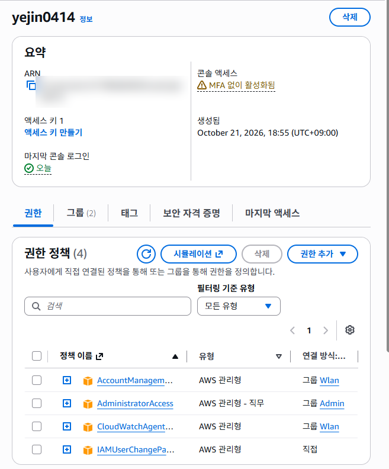

*IAM 사용자의 권한 화면. CloudWatchAgent 정책이 그룹을 통해 '사람'에게 붙어 있음 (ARN의 계정 ID는 가림)*

| | 권한을 쓰는 주체 | 붙이는 곳 |
|---|---|---|
| IAM 사용자·그룹 | 콘솔에 로그인하는 사람 | 사용자 / 그룹 |
| **IAM 역할** | EC2 안의 프로그램(에이전트, 앱) | **EC2 인스턴스** |

```bash
# 서버에 역할이 붙어 있는지 확인 (IMDSv2)
TOKEN=$(curl -sX PUT http://169.254.169.254/latest/api/token -H "X-aws-ec2-metadata-token-ttl-seconds: 60")
curl -s -H "X-aws-ec2-metadata-token: $TOKEN" http://169.254.169.254/latest/meta-data/iam/info
# 역할 연결 후
sudo systemctl restart amazon-cloudwatch-agent
```
**배운 점**: 서버 권한은 액세스 키를 서버에 두지 않고 **역할**로 준다. 사람용 그룹에 붙인 불필요한 정책은 제거.

---

## 보안·비용 체크리스트

**보안**
- [ ] 보안 그룹 SSH(22) 소스를 `내 IP`로 축소
- [ ] 루트·IAM 사용자 모두 MFA (IAM 사용자 'MFA 없이 활성화됨' 경고 해결)
- [ ] 사용자 그룹에 붙인 `CloudWatchAgentServerPolicy` 제거 (역할에만 필요)
- [ ] `.env`는 `chmod 600`, 깃허브·채팅에 올리지 않기 (`.gitignore`에 포함)
- [ ] DB 비밀번호·Django 시크릿 키를 충분히 긴 랜덤 값으로
- [ ] 기본 생성된 `test` DB 삭제: `sudo mysql -e "DROP DATABASE IF EXISTS test;"`
- [ ] 도메인 + HTTPS(Let's Encrypt) 적용 후 `.env`의 `USE_HTTPS=true`

**비용**
- [o] CloudWatch 경보 + SNS 이메일 알림
- [ ] 결제 알림(예산) 설정
- [ ] 다 쓰면: EC2 종료 → 탄력적 IP **릴리스** → EBS 볼륨·스냅샷 확인

---

## 회고

**한 일**: EC2 1대에 Nginx·Gunicorn·Django·MariaDB를 직접 구성해 쇼핑몰을 배포하고, IAM 역할로 CloudWatch 에이전트를 연결해 메모리·디스크·로그·경보까지 모니터링을 붙였습니다.

| 영역 | 겪은 문제 | 핵심 |
|---|---|---|
| IAM | 그룹에 정책 없음, 사용자와 역할 혼동 | 권한은 '정책'에서 나오고, 서버 권한은 역할로 |
| 리눅스 권한 | `.pem` 권한, `/var/lib/mysql` 700, `.env` 600, 홈 디렉터리 711 | 누가(소유자·그룹) 무엇을(rwx) 할 수 있는지 |
| DB | unix_socket, 테스트 DB 권한 | root는 sudo로만, 앱은 전용 계정·최소 권한 |
| 모니터링 | 메모리 지표 부재, 차원 묶음 | 기본 지표의 한계와 에이전트의 역할 |

공통적으로 **에러 메시지의 코드와 문구(403, 1044, errno 13, `no identity-based policy`)를 그대로 읽고, 어느 계층(권한·네트워크·설정)의 문제인지 좁혀 가는 방식**으로 해결했습니다. 무선랜 운영에서 증상 → 범위 좁히기 → 원인 확인 순서로 장애를 다루던 방식이 클라우드에서도 그대로 쓰였습니다.

## 다음 할 일
- [ ] IAM 역할 연결 → S3 상품 이미지 저장 (`.env`의 `USE_S3=true`)
- [ ] Django(Gunicorn) 로그도 파일로 남겨 CloudWatch Logs로 수집
- [ ] 도메인 연결 + HTTPS
- [ ] DB 백업 자동화(cron), 트래픽이 늘면 DB를 RDS로 분리
- [ ] 실결제 전환: 사업자등록·통신판매업 신고 → 토스페이먼츠 계약 → 라이브 키 교체
